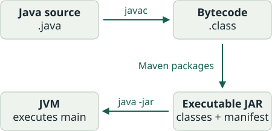

# Module 0 — Set up and trace a Java program

The credit preview should print the invoice number the caller supplied. How would you prove it picked up that value? Think about how you would check a parameter passed to a COBOL job and what you would look for in the job output.

On the first run, look for `Credit preview for invoice INV-2042`. What should change if you pass `INV-3050` to the same program?

**Learning objective** — Build and run the preview, then use the source, packaged program, and debugger to trace how an invoice number reaches the console.

**Pilot estimate** — 45–60 minutes with JDK 21 and Git ready. Installation and the first Maven download may take extra time.

**Ready to continue** — You can point to the invoice ID in the debugger and explain what the compiler, Maven, and the JVM each did.

Maven coordinates the build, runs the tests, and produces the [Java archive (JAR)](../../course/glossary.md#jar) you will run. This lab uses the supplied program as-is.

## Set up the environment

You need [Java Development Kit (JDK)](../../course/glossary.md#jdk) 21 and Git. Run these checks in the terminal. The first three commands should report major version 21. Git should print a version.

```text
java -version
javac -version
jdb -version
git --version
```

<details>
<summary>Install or select the tools if a version check fails</summary>

Install JDK 21 for your operating system and architecture. Use your organization's approved distribution or follow the vendor's install guide. [Eclipse Temurin installation guide](https://adoptium.net/installation/) · [Git installation guide](https://git-scm.com/install/)

If your machine has multiple JDKs, point `JAVA_HOME` at the JDK 21 directory and put that JDK's `bin` directory first on `PATH`. Reopen the terminal after changing persistent settings and rerun the version checks.

</details>

<details>
<summary>Get a checkout if you need one</summary>

Replace `COURSE_REPOSITORY_URL` with the URL supplied by your instructor.

```text
git clone COURSE_REPOSITORY_URL perform-to-platform
cd perform-to-platform
```

</details>

From the repository root, go to the lab directory.

```text
cd modules/00-orientation
```

## Build and test

Run the command for your shell. The included [Maven Wrapper](../../course/glossary.md#maven-wrapper) fetches the course's Maven version on first use.

| Shell | Command |
| --- | --- |
| macOS or Linux | `./mvnw clean verify` |
| Windows PowerShell or Command Prompt | `.\mvnw.cmd clean verify` |

Look for `Tests run: 1, Failures: 0, Errors: 0, Skipped: 0` and `BUILD SUCCESS`. The passing [JUnit](../../course/glossary.md#junit) test checks the preview message. You now have a JAR to run.

<details>
<summary>Find the build files or troubleshoot the first build</summary>

| Path | What to look for |
| --- | --- |
| `pom.xml` | Build configuration and dependencies |
| `src/main/java/` | Application source |
| `src/test/java/` | Test source |
| `target/classes/` | Compiled application classes |
| `target/surefire-reports/` | JUnit test results |
| `target/module-0-orientation.jar` | Packaged application |

Git ignores `target/` because Maven can regenerate these files from the source and build configuration.

If the build uses a different Java version than your terminal, run the wrapper with `-v` and check which Java home it reports. The first build also needs to download build plugins and JUnit. For download failures, check your organization's network or Maven mirror setup. [Maven Wrapper documentation](https://maven.apache.org/tools/wrapper/)

</details>

## Run the JAR

1. Launch the same JAR with the two invoice numbers from your shell.

   ```text
   java -jar target/module-0-orientation.jar INV-2042
   java -jar target/module-0-orientation.jar INV-3050
   ```

   Compare the expected console output with your prediction.

   ```text
   Credit preview for invoice INV-2042
   Credit preview for invoice INV-3050
   ```

2. Diagnose a launch failure. Run `java -jar target/missing-orientation.jar INV-2042`. Which part of the command tells you what could not be found? Rerun with the JAR path from the successful build and confirm the expected output.

## Read the preview program

The two runs show the output follows the input. Open the source and find the two lines inside `main` that make that happen. [CreditPreview.java](src/main/java/training/performtoplatform/orientation/CreditPreview.java)

```java
String invoiceId = args.length == 0 ? "INV-1001" : args[0];
System.out.println(previewMessage(invoiceId));
```

- `args` is the array of command-line arguments. Read `condition ? valueIfTrue : valueIfFalse` as a choice between two values. Java evaluates only the selected branch. When the array is empty, the expression uses `INV-1001`. Otherwise, `args[0]` reads the first argument.
- `previewMessage(invoiceId)` passes that value to the helper and returns the complete line. `System.out` is Java's standard output stream. Its `println` method writes the line and ends it with a line break. Find the supplied JUnit assertion that checks the helper's result. [CreditPreviewTest.java](src/test/java/training/performtoplatform/orientation/CreditPreviewTest.java)

The launcher calls `public static void main(String[] args)` to start this program. `public` makes the method accessible, `static` lets the launcher call it without creating an object, and `void` means the method returns no value. The `package` declaration gives `CreditPreview` its full name, `training.performtoplatform.orientation.CreditPreview`. You will find that name in the JAR and use it in the debugger.

A class groups methods and can also define the data each object holds. Here, `CreditPreview` names the class the launcher starts, much like finding a COBOL program by its `PROGRAM-ID`. This class only uses static methods. The `final` on the class declaration prevents another class from extending it.

## Inspect the JAR

How did `java -jar` know which program to start? The compiler in the JDK produces `.class` files containing [bytecode](../../course/glossary.md#bytecode). Maven packages those files and a manifest into the JAR. The Java launcher reads the manifest, and the [Java Virtual Machine (JVM)](../../course/glossary.md#jvm) runs the compiled program.



1. List the JAR's contents. Find `META-INF/MANIFEST.MF` and `training/performtoplatform/orientation/CreditPreview.class`.

   ```text
   jar tf target/module-0-orientation.jar
   ```

2. Extract the manifest inside `target/`.

   ```text
   cd target
   jar xf module-0-orientation.jar META-INF/MANIFEST.MF
   cd ..
   ```

   Open `target/META-INF/MANIFEST.MF` in your editor and find the entry below. Maven writes it from the POM's `mainClass` setting. The Java launcher reads it to choose the class whose `main` method to call. [Build configuration](pom.xml)

   ```text
   Main-Class: training.performtoplatform.orientation.CreditPreview
   ```

<details>
<summary>Optional exploration — match a source line to bytecode</summary>

Run `javap` to display the compiled instructions. Find the `invokestatic` line in `main` that calls `previewMessage` and match it to the call in the source.

```text
javap -c -classpath target/module-0-orientation.jar training.performtoplatform.orientation.CreditPreview
```

</details>

## Trace execution in the debugger

The output shows which ID was printed. Check what was actually passed to `previewMessage` while the program was running. Start the JDK's command-line debugger. The classpath tells it where to find the compiled class, and the full class name tells it where to start. [JDK 21 debugger reference](https://docs.oracle.com/en/java/javase/21/docs/specs/man/jdb.html)

```text
jdb -classpath target/module-0-orientation.jar training.performtoplatform.orientation.CreditPreview INV-2042
```

At the debugger prompt, set a [breakpoint](../../course/glossary.md#breakpoint) and start the program.

```text
stop in training.performtoplatform.orientation.CreditPreview.previewMessage
run
```

Wait for `Breakpoint hit`. At the suspended prompt, enter the following commands one at a time.

```text
where
locals
cont
```

`where` shows `previewMessage` called from `main`. `locals` shows the method argument `invoiceId` with the value `INV-2042`. After `cont`, look for the preview line and the application exit. If you use a Java IDE instead, import the lab as a Maven project, choose JDK 21, and debug `CreditPreview.main` with the argument `INV-2042`. Set your breakpoint on the return statement in `previewMessage` and inspect the same argument and call stack.

## Completion criteria

- Show Git and JDK 21 version output, then run the Maven Wrapper from the lab directory.
- Show a successful build with one passing JUnit test.
- Launch the JAR with both sample inputs and show that the invoice ID in the output follows the input. Explain the bad-path launch error and show a successful retry.
- Locate the JAR's compiled class and `Main-Class` entry. Use them to explain what happens when you run `java -jar`.
- Show the debugger paused in `previewMessage`, with `main` in the call stack and `invoiceId` equal to `INV-2042`. Resume execution and confirm the preview prints.
- Explain in your own words what the compiler, Maven, and the JVM each do.

Next, use the same toolchain to translate and test a credit-validation rule in [Module 1](../01-business-rules/README.md).
