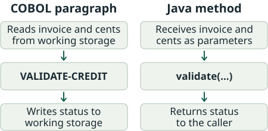

# Module 1 — Carry a COBOL business rule into Java

A credit request arrives with a blank invoice number and a zero amount. The caller gets one status code. Which problem should it report first? Trace the COBOL paragraph the way you would before replacing a production rule, then check that Java gives the caller the same answer.

**Learning objective** — Translate a COBOL credit-validation rule into Java and use tests to verify the status codes, amount boundary, and order of the checks.

**Pilot estimate** — 45–60 minutes for the COBOL comparison plus 15–30 minutes for the new rule, after completing [Module 0](../00-orientation/README.md).

**Ready to continue** — Your restored rule passes all 11 baseline cases. Your new maximum rule passes its boundary and precedence tests.

## Read the COBOL rule

Trace the `VALIDATE-CREDIT` paragraph and write down the status you expect for each case before opening the answer key or the Java implementation. Note which check decides the outcome in case F. [Reference COBOL program](reference/credit-validation.cob)

| Case | Invoice number | Requested cents |
| --- | --- | ---: |
| A | `INV-1001` | 1250 |
| B | `INV-1001` | 1 |
| C | Filled with spaces | 1250 |
| D | `INV-1001` | 0 |
| E | `INV-1001` | -1 |
| F | Filled with spaces | 0 |

<details>
<summary>Check your predictions</summary>

| Case | Status | Meaning |
| --- | --- | --- |
| A | `00` | Valid request |
| B | `00` | Smallest positive amount |
| C | `04` | Invoice number required |
| D | `08` | Amount must be positive |
| E | `08` | Amount must be positive |
| F | `04` | Invoice check runs first |

</details>

## Build and test

Use the JDK 21 and Git setup from Module 0. From the repository root, run `cd modules/01-business-rules`. Use the Maven Wrapper command for your shell to build and test the supplied reference. [Module 0 setup](../00-orientation/README.md#set-up-the-environment)

| Shell | Command |
| --- | --- |
| macOS or Linux | `../00-orientation/mvnw clean verify` |
| Windows PowerShell or Command Prompt | `..\00-orientation\mvnw.cmd clean verify` |

Look for `Tests run: 11, Failures: 0, Errors: 0, Skipped: 0` and `BUILD SUCCESS`. This [parameterized JUnit test](../../course/glossary.md#parameterized-test) runs the same status-code assertion once for each named input. The rows in `creditCases` supply the inputs and expected results. [CreditValidationTest.java](src/test/java/training/performtoplatform/credit/CreditValidationTest.java)

`@ParameterizedTest` tells JUnit to run the method for multiple cases. `@MethodSource("creditCases")` names the method supplying the rows. Read `Stream<Arguments>` as a sequence of argument rows. Each `arguments(...)` call gives one invocation its values in parameter order. The `import static` lines let you call `arguments` and `assertEquals` by their short names.

## Run the JAR

Run these commands in your shell after the passing build. The first argument is the invoice number and the second is the amount in whole cents.

```text
java -jar target/module-1-business-rules.jar INV-1001 1250
java -jar target/module-1-business-rules.jar INV-1001 0
java -jar target/module-1-business-rules.jar "            " 0
```

Expected output, in order. Compare the third result with your prediction for case F.

```text
00
08
04
```

## Translate the paragraph

The COBOL paragraph reads and writes working storage. The Java method declares its inputs and returns the status directly. In `validate(String invoiceNumber, long requestedCents)`, `String` holds the invoice text and `long` holds signed whole cents. The [status code](../../course/glossary.md#status-code) is a string such as `"04"` so the caller still sees the leading zero. [CreditValidation.java](src/main/java/training/performtoplatform/credit/CreditValidation.java)

`validate` is `static`, so the caller needs only the class and the two input values. With no access modifier, the method is package-private, which lets tests in the same package call it. The `private static final` status fields belong to the class, can be used inside it, and are assigned once.

In `main`, `Long.parseLong(args[1])` converts argument text to a signed 64-bit integer. Invalid text or a value outside that range throws `NumberFormatException`. The `L` in a test value like `1_250L` marks a `long` literal. The underscores only help you read the digits. A Java `long` can hold `1_000_000_000L`, which exceeds the nine-digit COBOL field. The Java `String` also accepts more than the COBOL field's 12 characters, and `isBlank()` recognizes whitespace beyond an ordinary space. This lab compares the rule for the listed cases; it does not preserve every input constraint of the COBOL program. When translating a production interface, specify and test its length, character, numeric-range, and malformed-input behavior explicitly.

`throw new IllegalArgumentException(...)` stops normal execution of `main` when the argument count is wrong. An exception travels back through callers until code catches it. Here it reaches the launcher and the run fails with an error message, a different path from returning a credit status for a business rejection.



1. In your working copy, replace the statements inside `validate` with `return VALID;`. Leave the tests in place.
2. Run the build command again. Four valid cases pass and seven rejection cases fail. Pick one failing test and explain the difference between the expected and actual status.
3. Rebuild the rule from the COBOL paragraph and answer key. Check for a missing invoice first, then check the signed amount, then return the valid status. Each Java `return` ends the method, so the first matching check decides the result. Keep console output in `main` so the tests can call the rule directly.

   <details>
   <summary>Hint — check for a missing invoice in Java</summary>

   ```java
   if (invoiceNumber == null || invoiceNumber.isBlank()) {
       return INVOICE_REQUIRED;
   }
   ```

   The left side of `||` checks for a missing string reference. When that side is true, Java uses [short-circuit evaluation](../../course/glossary.md#short-circuit-evaluation) and skips the right side. Otherwise, `isBlank()` checks for an empty string or one containing only whitespace. In the COBOL cases, a field filled with spaces represents a missing invoice.

   </details>

4. Rerun the build and confirm that all 11 cases pass. Explain why zero is rejected, one cent is accepted, and a missing invoice wins when both inputs are invalid.

<details>
<summary>Optional challenge — reverse the order of the checks</summary>

After all 11 baseline tests pass, predict which named case would fail if the amount check ran first. In your working copy, put the amount check before the invoice check and rerun the tests. Compare the failing case with your prediction and explain why the cases with only one invalid input still pass. Restore the original order and rerun the tests.

</details>

## Add a maximum request rule

The business now limits an individual credit request to $1,000. Return status `12` above 100,000 cents. Keep the missing-invoice and nonpositive-amount checks first. Use a disposable working copy for this change so you can rerun the original COBOL comparison separately.

1. Predict the status for each row before editing the rule.

   | Invoice | Requested cents |
   | --- | ---: |
   | `INV-1001` | 99,999 |
   | `INV-1001` | 100,000 |
   | `INV-1001` | 100,001 |
   | Missing (`null`) | 100,001 |

2. Add the four named cases to `creditCases`. The existing row for `999_999_999L` reaches the new limit check. Rename that case to describe the new rule and update its expected status. Run the tests before changing `validate` and find the new rejections that still return `00`.
3. Add a named status constant and implement the rule in `validate`. Rerun `clean verify` and show 15 passing cases. Explain which check wins when the invoice is missing and the amount exceeds the limit.

<details>
<summary>Optional exploration — run the same case in COBOL</summary>

If you have GnuCOBOL on macOS or Linux, use the same inputs to check the original paragraph. Run these commands after the Maven build creates `target/`. The reference program reads the invoice number and amount on separate lines. This case should produce `04` in both languages.

```sh
cobc -x -o target/credit-validation-cobol reference/credit-validation.cob
printf '%s\n' '            ' '0' | ./target/credit-validation-cobol
java -jar target/module-1-business-rules.jar "            " 0
```

</details>

## Completion criteria

- Write a prediction for each input before revealing the answer key. Use `VALIDATE-CREDIT` to explain any difference between your prediction and the expected status.
- Show a named rejection case failing when the Java starting point returns `00` for every input. Explain the expected and actual codes.
- Translate the rule and show all 11 parameterized cases passing with their original expected statuses.
- Run the JAR for the three sample inputs and match each displayed status to its business rule.
- Explain how the Java method gets its inputs and returns its result, why zero and one cent differ, and which check determines the status when both inputs are invalid.
- Show the new maximum rule failing before implementation and passing afterward. Identify the existing test expectation changed by the new policy.

Next, express money, business dates, and validation outcomes with explicit types in [Module 2](../02-domain-modeling/README.md).
